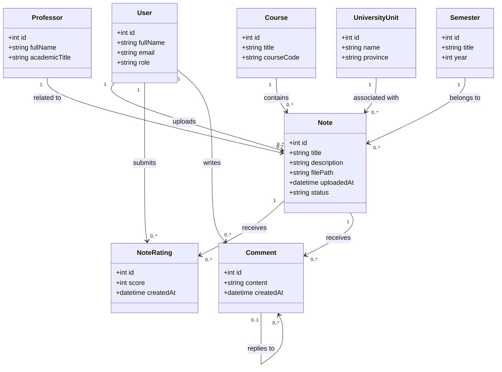
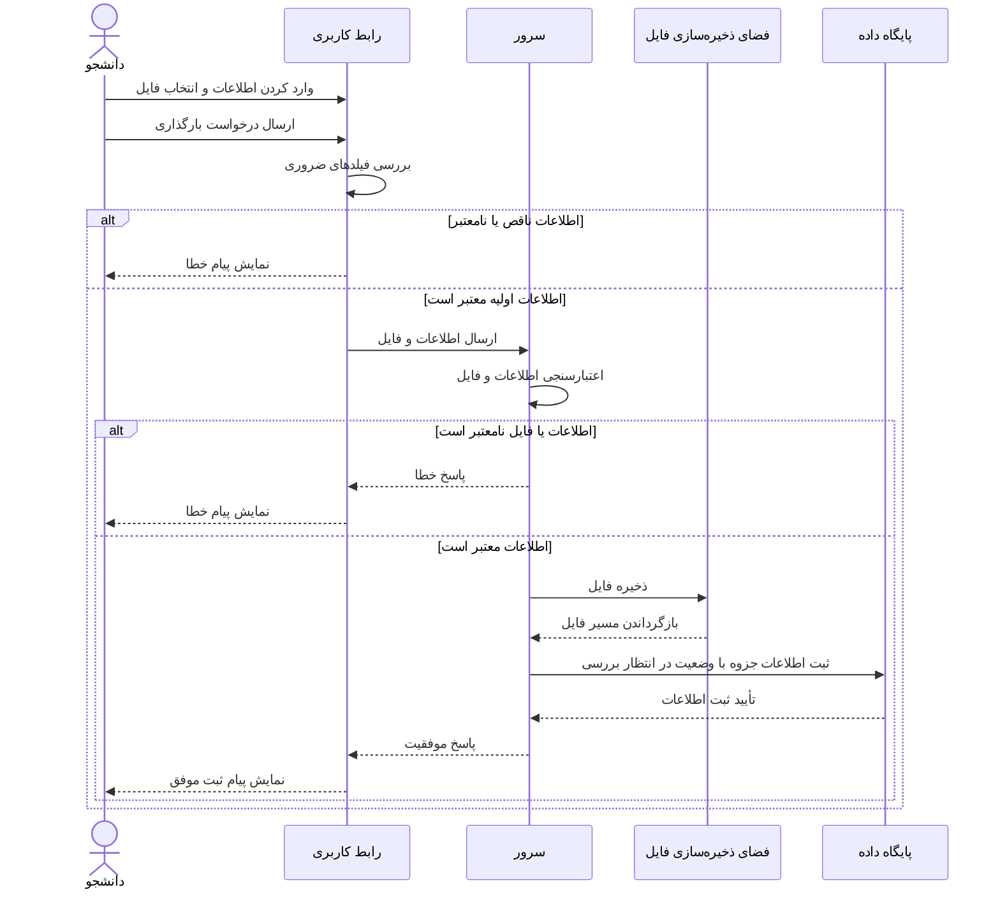

# UML Diagrams - کلاس‌یار (ClassYar)

## 1. هدف (Purpose)

هدف از این مستند، بررسی مدل‌های ایستا (Static Model) و پویا (Dynamic Model) در پروژهٔ کلاس‌یار است. این سامانه یک پلتفرم تحت وب برای اشتراک‌گذاری جزوه‌ها و نمونه‌سؤالات دانشگاهی است که کاربران می‌توانند در آن مطالب آموزشی را جست‌وجو کنند، جزوه بارگذاری کنند، به محتوا امتیاز بدهند و با یکدیگر تعامل داشته باشند.

در این مستند، نمودار کلاس (Class Diagram) برای نمایش ساختار ایستای سامانه و نمودار توالی (Sequence Diagram) برای نمایش ترتیب تعامل اجزای سامانه هنگام بارگذاری جزوه ارائه می‌شود.

## 2. بررسی مدل‌های ایستا و پویا (Static and Dynamic Models)

### 2.1. مدل ایستا (Static Model)

مدل ایستا ساختار سامانه را مستقل از ترتیب اجرای عملیات نشان می‌دهد. در این مدل، کلاس‌های اصلی، ویژگی‌های آن‌ها و ارتباط میان کلاس‌ها بررسی می‌شوند.

در پروژهٔ کلاس‌یار، کلاس‌هایی مانند User، Professor، Course، UniversityUnit، Semester و Note برای نمایش کاربران، استادان، درس‌ها، واحدهای دانشگاهی، نیم‌سال‌های تحصیلی و جزوه‌ها در نظر گرفته شده‌اند.

### 2.2. مدل پویا (Dynamic Model)

مدل پویا رفتار سامانه را هنگام اجرای یک فرایند مشخص نمایش می‌دهد. در این مدل، ترتیب پیام‌ها و تعامل میان کاربر، رابط کاربری، سرور و پایگاه داده بررسی می‌شود.

در پروژهٔ کلاس‌یار، فرایند بارگذاری جزوه به‌عنوان نمونه انتخاب شده است. در این فرایند، دانشجو اطلاعات جزوه را وارد می‌کند، سامانه اطلاعات را اعتبارسنجی می‌کند و در صورت موفقیت، جزوه را با وضعیت «در انتظار بررسی» ثبت می‌کند.

## 3. نمودار کلاس (Class Diagram)

نمودار کلاس، مدل ایستای پروژهٔ کلاس‌یار را نشان می‌دهد. این نمودار شامل کلاس‌های اصلی، ویژگی‌های مهم و روابط میان آن‌هاست.

### 3.1. توضیح کلاس‌ها (Class Description)

- **User:** اطلاعات پایهٔ کاربران سامانه را نگهداری می‌کند. ویژگی `role` نقش کاربر، مانند دانشجو، استاد یا مدیر سامانه، را مشخص می‌کند.
- **Professor:** اطلاعات اصلی استادان را نگهداری می‌کند تا جزوه‌ها و مطالب آموزشی به استاد مربوط به خود متصل شوند.
- **UniversityUnit:** نام واحد دانشگاهی و استان آن را نگهداری می‌کند و امکان دسته‌بندی و جست‌وجوی محتوا بر اساس محل دانشگاه را فراهم می‌سازد.
- **Course:** اطلاعات درس‌های دانشگاهی را نگهداری می‌کند.
- **Semester:** نیم‌سال و سال تحصیلی مربوط به جزوه را مشخص می‌کند.
- **Note:** اطلاعات جزوه، توضیحات، مسیر فایل، زمان بارگذاری و وضعیت بررسی را نگهداری می‌کند. وضعیت جزوه می‌تواند برای مثال در انتظار بررسی، تأییدشده یا ردشده باشد.
- **NoteRating:** امتیازی را که یک کاربر به یک جزوه می‌دهد ثبت می‌کند.
- **Comment:** دیدگاه کاربران دربارهٔ جزوه‌ها و ارتباط احتمالی میان دیدگاه و پاسخ آن را نمایش می‌دهد.

### 3.2. توضیح روابط (Relationships)

هر کاربر می‌تواند چند جزوه بارگذاری کند و هر جزوه به یک بارگذار مرتبط است. همچنین هر جزوه به یک استاد، یک درس، یک واحد دانشگاهی و یک نیم‌سال مربوط می‌شود.

هر کاربر می‌تواند برای جزوه‌ها امتیاز ثبت کند و دیدگاه بنویسد. هر جزوه نیز می‌تواند چندین امتیاز و دیدگاه دریافت کند. رابطهٔ بازگشتی کلاس Comment امکان پاسخ‌دادن به یک دیدگاه را نشان می‌دهد.

**نکته:** این نمودار یک مدل مفهومی و منطقی پیشنهادی برای پروژه است. نام‌گذاری دقیق فیلدها و نوع روابط باید هنگام پیاده‌سازی با مدل‌های واقعی پایگاه داده هماهنگ شود.

## 4. نمودار توالی (Sequence Diagram)

نمودار توالی، مدل پویای سامانه را با نمایش ترتیب تعامل میان اجزای مختلف در یک سناریوی مشخص نشان می‌دهد.

سناریوی انتخاب‌شده، بارگذاری جزوه توسط دانشجو است. در این فرایند، دانشجو باید اطلاعات لازم، شامل عنوان جزوه، استاد، درس، واحد دانشگاهی، نیم‌سال و فایل را وارد کند.

### 4.1. توضیح فرایند (Process Description)

1. دانشجو اطلاعات موردنیاز جزوه را در رابط کاربری وارد و فایل را انتخاب می‌کند.
2. رابط کاربری فیلدهای ضروری را بررسی می‌کند. اگر اطلاعات اولیه ناقص باشد، پیام خطا نمایش داده می‌شود.
3. در صورت معتبر بودن اطلاعات اولیه، درخواست بارگذاری به سرور ارسال می‌شود.
4. سرور اطلاعات و فایل را اعتبارسنجی می‌کند. اگر فایل یا اطلاعات معتبر نباشد، فرایند با نمایش خطا متوقف می‌شود.
5. در صورت موفقیت اعتبارسنجی، فایل در فضای ذخیره‌سازی قرار می‌گیرد.
6. سرور اطلاعات جزوه و مسیر فایل را در پایگاه داده ثبت می‌کند و وضعیت جزوه را «در انتظار بررسی» قرار می‌دهد.
7. پس از ثبت موفق، پیام تأیید به رابط کاربری بازگردانده می‌شود و دانشجو از موفقیت بارگذاری مطلع می‌شود.

در این نمودار، بخش `alt` دو حالت جایگزین را نشان می‌دهد: موفقیت یا شکست اعتبارسنجی. این موضوع کمک می‌کند رفتار سامانه در شرایط عادی و شرایط خطا مشخص باشد.

## 5. تفاوت مدل ایستا و پویا در پروژهٔ کلاس‌یار

مدل ایستا ساختار داده‌ها و روابط میان اجزای سامانه را نشان می‌دهد؛ برای مثال، ارتباط جزوه با استاد، درس و نیم‌سال. در مقابل، مدل پویا ترتیب اجرای یک فرایند و پیام‌های ردوبدل‌شده میان اجزای سامانه را نمایش می‌دهد؛ برای مثال، مراحل بارگذاری و ثبت جزوه.

بنابراین، این دو مدل مکمل یکدیگر هستند: نمودار کلاس مشخص می‌کند سامانه از چه کلاس‌ها و ارتباطاتی تشکیل شده است، درحالی‌که نمودار توالی نشان می‌دهد اجزای سامانه در زمان اجرای یک عملیات چگونه با یکدیگر تعامل می‌کنند.

## 6. نتیجه‌گیری (Conclusion)

در این مستند، دو جنبهٔ اصلی مدل‌سازی سامانهٔ کلاس‌یار بررسی شد. نمودار کلاس، ساختار ایستای سامانه و ارتباط میان موجودیت‌های اصلی را نمایش می‌دهد. نمودار توالی نیز رفتار پویای سامانه را در سناریوی بارگذاری جزوه نشان می‌دهد.

ترکیب این دو نمودار به درک بهتر ساختار و رفتار سامانه کمک می‌کند و می‌تواند مبنایی برای طراحی دقیق‌تر پایگاه داده و پیاده‌سازی بخش‌های مختلف پروژه باشد.
