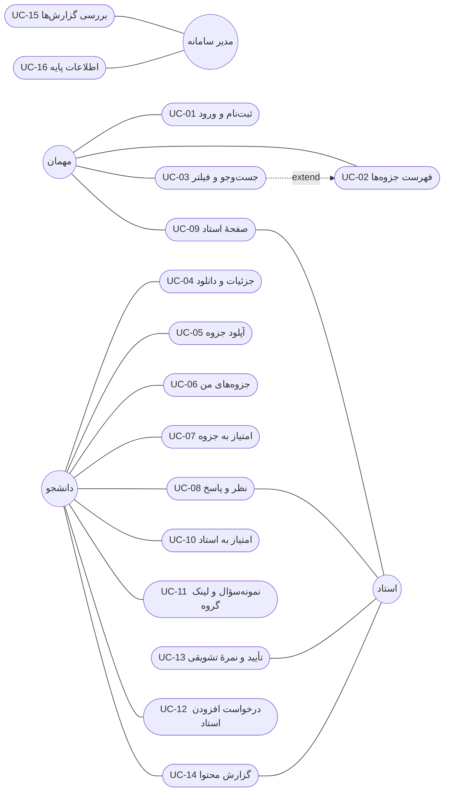

# Use Case Diagram — کلاس‌یار

| | |
|---|---|
| **نام پروژه** | کلاس‌یار (ClassYar) |
| **نسخهٔ سند** | ۱.۰ |
| **تاریخ** | ۱۴۰۵/۰۸/۰۲ |
| **تهیه‌کنندگان** | مریم قندی زنجانی، ملیکا شهبازی، آنیسا فروغمند، مائده رضایی، محمدمهدی ذوالقدر |
| **وضعیت** | پیش‌نویس |
| **مرجع** | `docs/02-requirements/user-stories.md` و `docs/02-requirements/personas.md` |

---

## ۱. مقدمه

این سند نشان می‌دهد **چه کسی** (Actor) با سامانهٔ کلاس‌یار **چه کاری** (Use Case) انجام می‌دهد.
هر Use Case از یک یا چند User Story سند داستان‌های کاربر ساخته شده است، تا
نیازمندی‌ها و طراحی به هم وصل بمانند. این سند «نمای Use Case» از مدل 4+1 است
و بقیهٔ نماها (منطقی، فرایند، استقرار) بر پایهٔ آن ساخته می‌شوند.

---

## ۲. Actorها

| Actor | نقش | پرسونا |
|-------|------|--------|
| مهمان | بازدیدکنندهٔ ثبت‌نام‌نکرده؛ فقط می‌بیند و جست‌وجو می‌کند | — |
| دانشجو | جزوه می‌خواند، دانلود می‌کند، آپلود می‌کند، امتیاز و نظر می‌دهد | نگار، امیرحسین |
| استاد | جزوه‌های درس خودش را تأیید می‌کند و نمرهٔ تشویقی ثبت می‌کند | دکتر کاظمی |
| مدیر سامانه | اطلاعات پایه و گزارش‌ها را مدیریت می‌کند | خانم نوروزی |

دانشجو همهٔ کارهای مهمان را هم می‌تواند انجام دهد (رابطهٔ تعمیم).

---

## ۳. فهرست Use Caseها

| ID | Use Case | Actor | User Story |
|----|----------|-------|------------|
| UC-01 | ثبت‌نام و ورود | مهمان، دانشجو، استاد، مدیر | US-01 |
| UC-02 | مشاهدهٔ فهرست جزوه‌ها | مهمان، دانشجو | US-04 |
| UC-03 | جست‌وجو و فیلتر جزوه‌ها | مهمان، دانشجو | US-07 |
| UC-04 | مشاهدهٔ جزئیات و دانلود جزوه | دانشجو | US-05 |
| UC-05 | آپلود جزوه | دانشجو | US-03 |
| UC-06 | مدیریت جزوه‌های من | دانشجو | US-06 |
| UC-07 | امتیازدادن به جزوه | دانشجو | US-08 |
| UC-08 | نوشتن نظر و پاسخ | دانشجو، استاد | US-09 |
| UC-09 | مشاهدهٔ صفحهٔ استاد | مهمان، دانشجو، استاد | US-10 |
| UC-10 | امتیازدادن به استاد | دانشجو | US-11 |
| UC-11 | ثبت نمونه‌سؤال و لینک گروه | دانشجو | US-12 |
| UC-12 | درخواست افزودن استاد | دانشجو | US-02 |
| UC-13 | تأیید جزوه و ثبت نمرهٔ تشویقی | استاد | US-13 |
| UC-14 | گزارش محتوای نامناسب | دانشجو، استاد | US-14 |
| UC-15 | بررسی گزارش‌ها و حذف محتوا | مدیر سامانه | US-15 |
| UC-16 | مدیریت اطلاعات پایه | مدیر سامانه | US-02 |

هر ۱۵ User Story حداقل در یک Use Case پوشش داده شده است.

---

## ۴. دیاگرام

**نحوهٔ خواندن:**
- دایره‌ها Actor و بیضی‌ها Use Case هستند و خط ساده یعنی «این Actor این کار را انجام می‌دهد».
- دانشجو همهٔ کارهای مهمان (UC-02، UC-03، UC-09) را هم می‌تواند انجام دهد؛ برای خوانایی این خط‌ها رسم نشده است.
- UC-01 (ثبت‌نام و ورود) برای همهٔ Actorهاست و فقط برای خوانایی به مهمان وصل شده است.
- خط‌چین `extend`: جست‌وجو و فیلتر، فهرست جزوه‌ها را گسترش می‌دهد.
- هر Use Case که Actor دانشجو، استاد یا مدیر دارد، پیش‌شرطش ورود به حساب (UC-01) است.

---

## ۵. سناریوی اصلی — از آپلود تا ارزیابی

1. امیرحسین وارد حسابش می‌شود (UC-01).
2. جزوهٔ «تحقیق در عملیات» را با استاد، درس، واحد و ترم آپلود می‌کند (UC-05).
3. نگار شب امتحان استاد و واحد را فیلتر می‌کند (UC-03) و جزوه را در فهرست می‌بیند (UC-02).
4. جزئیات و امتیازها را می‌خواند و جزوه را دانلود می‌کند (UC-04).
5. بعد از امتحان به جزوه امتیاز می‌دهد (UC-07) و نظر می‌نویسد (UC-08).
6. دکتر کاظمی جزوه را بررسی و تأیید می‌کند و نمرهٔ تشویقی ثبت می‌کند (UC-13).
7. اگر محتوایی نامناسب باشد، گزارش می‌شود (UC-14) و مدیر آن را حذف می‌کند (UC-15).

---

## ۶. فرض‌ها

- مشاهدهٔ فهرست، جست‌وجو و صفحهٔ استاد برای مهمان آزاد است؛ دانلود و هر نوع مشارکت نیازمند ورود است.
- نقش «مشارکت‌کننده» نقش جدا ندارد؛ هر دانشجو هم استفاده‌کننده است و هم مشارکت‌کننده.
- حساب استاد پس از تأیید مدیر فعال می‌شود (US-01).

---

## پیوست الف — تاریخچهٔ تغییرات

| نسخه | تاریخ | تغییرات | تهیه‌کننده |
|-------|-------|----------|--------------|
| ۱.۰ | ۱۴۰۵/۰۸/۰۲ | نسخهٔ اولیه | تیم کلاس‌یار |
